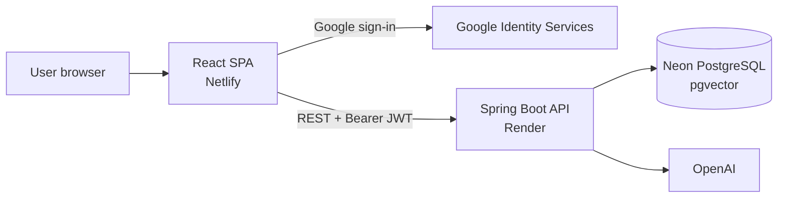
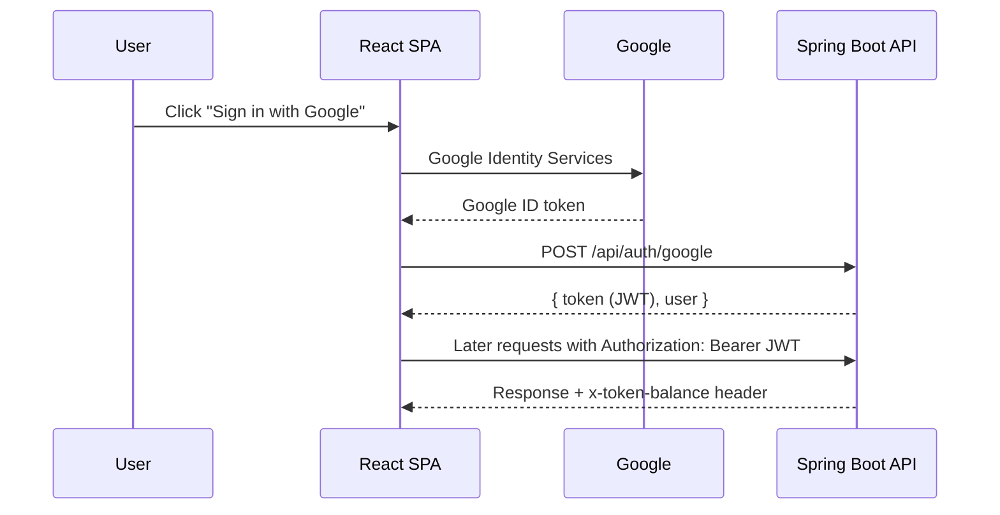

<div align="center">

# 🛒 SmartCart Frontend

**A responsive React storefront with Google sign-in, an AI shopping assistant and AI-assisted product listing, powered by a Spring Boot API.**

[](https://smartcart-soumadeep1221.netlify.app/)
[](https://github.com/Soumadeep1221/SmartCart_Backend)


</div>

> ⏳ The backend runs on a free Render instance. If the store shows no products at first, wait a minute or two and reload while the API wakes up.

---

## ✨ Highlights

| 🔐 Google sign-in | 🤖 AI shopping assistant | 🪙 Live AI credits |
|---|---|---|
| One-click sign-in through Google Identity Services. The backend swaps the Google token for its own JWT. | A floating chatbot answers questions about products and your own orders. | Remaining credits update after every AI action. The admin has unlimited use. |

---

## 🚀 Features

### 🛍️ Customer experience
- **Storefront** with category filters (Laptop, Headphone, Mobile, Electronics, Toys, Fashion) and debounced search.
- **Stock-aware shopping** with live stock counters, low-stock warnings and protection against ordering more than what is available.
- **Persistent cart** stored in the browser (LocalStorage) that survives reloads, with quantity controls and live totals.
- **Checkout modal** that collects the customer name and places the order.
- **AI chatbot** for product details, prices, stock and your own orders.

### 🔐 Authentication and access
- **Google sign-in** without the frontend ever handling passwords.
- **Route guards** (`RequireAuth`, `RequireAdmin`) for signed-in and admin-only pages.
- **Session handling:** a 401 response signs the user out and redirects to `/login`. A 403 shows a non-intrusive permission message.
- **Credit display:** regular users see their remaining AI credits, updated from the `x-token-balance` response header.

### 🧑‍💼 Product management and admin
- **Add products** with an image upload. The description and image can be generated with AI from the same form, which costs credits for regular users.
- **Admin only:** editing products, deleting products and viewing all customer orders with itemized breakdowns.

---

## 🧱 Tech stack

| Layer | Technologies |
|---|---|
| Core | React 18 |
| Build | Vite 5 with `@vitejs/plugin-react-swc` |
| Routing | React Router DOM 6 |
| UI | Bootstrap 5, React Bootstrap, Bootstrap Icons, custom design tokens |
| HTTP | Axios with interceptors |
| Authentication | Google Identity Services |
| Notifications | React Toastify |
| Code quality | ESLint 8 |

---

## 🏗️ Architecture



### Sign-in flow



<details>
<summary><b>📁 Project structure</b></summary>

```
SpringEcommerce_Frontend/
├── .env.example              # Sample environment configuration
├── .eslintrc.cjs             # ESLint configuration
├── index.html                # HTML entry point
├── package.json              # Dependencies and scripts
├── vite.config.js            # Vite configuration with SWC React plugin
├── public/
│   ├── _redirects            # Netlify SPA fallback (/* /index.html 200)
│   └── vite.svg
└── src/
    ├── main.jsx              # React root
    ├── App.jsx               # Routes, guards and layout
    ├── axios.jsx             # Axios instance, interceptors, base URL
    ├── assets/
    ├── components/
    │   ├── AddProduct.jsx        # Product form with AI generation
    │   ├── Cart.jsx              # Cart page and order summary
    │   ├── ChatBot.jsx           # Floating AI assistant
    │   ├── CheckoutPopup.jsx     # Customer details and order submission
    │   ├── Home.jsx              # Hero, category chips, product grid
    │   ├── Login.jsx             # Google sign-in screen
    │   ├── Navbar.jsx            # Navigation, search, profile menu
    │   ├── Order.jsx             # Admin order list
    │   ├── OrderSuccessModal.jsx # Order confirmation
    │   ├── Product.jsx           # Product detail view
    │   └── UpdateProduct.jsx     # Admin product editing
    ├── constants/
    │   └── categories.js     # Product categories
    ├── Context/
    │   ├── AuthContext.jsx   # Auth state, session check, token costs
    │   └── Context.jsx       # Product catalog, cart state, cache
    ├── styles/
    │   └── globals.css       # Design tokens and theme variables
    └── utils/
        ├── ai.js             # AI response and error handling
        └── formatters.js     # INR currency, dates, debounce
```

</details>

---

## 🏁 Getting started

### Prerequisites

- Node.js 18 or newer (20+ recommended) and npm
- The [SmartCart backend](https://github.com/Soumadeep1221/SmartCart_Backend), either running locally or deployed
- A Google Cloud OAuth 2.0 Web Client ID

### 1. Clone and install

```bash
git clone https://github.com/Soumadeep1221/SpringEcommerce_Frontend.git
cd SpringEcommerce_Frontend
npm install
```

### 2. Configure the environment

```bash
cp .env.example .env
```

| Variable | Required | Description | Example |
|---|---|---|---|
| `VITE_API_BASE_URL` | Yes | Backend origin. **Do not add `/api`**, because `src/axios.jsx` adds it to every request | `http://localhost:8080` |
| `VITE_GOOGLE_CLIENT_ID` | Yes | Google OAuth 2.0 Web Client ID | `xxxx.apps.googleusercontent.com` |

> ⚠️ Vite reads these variables **at build time**. After changing them on a hosting platform, trigger a new deploy.

### 3. Start the dev server

```bash
npm run dev
```

### Available scripts

| Command | Action |
|---|---|
| `npm run dev` | Starts the Vite dev server with hot reload |
| `npm run build` | Builds the production bundle into `dist/` |
| `npm run lint` | Runs ESLint on all `.js` and `.jsx` files |
| `npm run preview` | Serves the production build locally |

---

## 🔌 Connecting to the backend

Three settings have to line up, otherwise requests fail in the browser:

1. **Backend CORS.** The backend allows exactly one origin, set by its `FRONTEND_URL` variable. It must equal this app's origin character for character: `https://` included, no trailing slash. For local development, run the backend with `FRONTEND_URL=http://localhost:5173` and open the app on that same address, not on `127.0.0.1`.
2. **Google Cloud.** Add the app's origin (the Netlify URL, and your local one for development) under **Authorized JavaScript origins**. If the OAuth consent screen is still in testing mode, only the test users you added can sign in, so publish it for public use.
3. **Exposed header.** The backend exposes `X-Token-Balance` through CORS, which is how the credit counter works.

---

## 🌐 Deployment (Netlify)

1. Connect the repository to Netlify.
2. Build command: `npm run build`. Publish directory: `dist`.
3. Under **Site configuration → Environment variables**, add `VITE_API_BASE_URL` (your backend's HTTPS URL, with no trailing slash) and `VITE_GOOGLE_CLIENT_ID`.
4. Deploy.

`public/_redirects` contains `/*  /index.html  200`, so refreshing on any route works instead of returning a 404.

**Before going live:** the frontend and backend must both use HTTPS (browsers block HTTP API calls from an HTTPS page), and no secrets should be committed to the repository.

---

## 🧭 Good to know

- Sessions last **30 minutes**, the lifetime of the backend's JWT. After that the user signs in again.
- The cart lives in the browser's LocalStorage, so it is per browser and per device, not per account.
- New users start with 30 AI credits, and the costs of each AI action are read from the backend.
- The free-tier backend sleeps when idle, so the first request after a pause is slow.

---

## 🔗 Related repositories

- **Backend:** [SmartCart_Backend](https://github.com/Soumadeep1221/SmartCart_Backend) (Spring Boot, Spring AI, pgvector)
- **Frontend:** [SpringEcommerce_Frontend](https://github.com/Soumadeep1221/SpringEcommerce_Frontend) (this repository)

---

<div align="center">

## 👨‍💻 Author

**Soumadeep Dey** · Java Backend Developer

[](https://www.linkedin.com/in/soumadeep-dey-)
[](https://github.com/Soumadeep1221)
[](https://soumadeep-dey-portfolio.vercel.app/)

dey180343@gmail.com

⭐ If you like this project, consider giving the repository a star.

</div>
